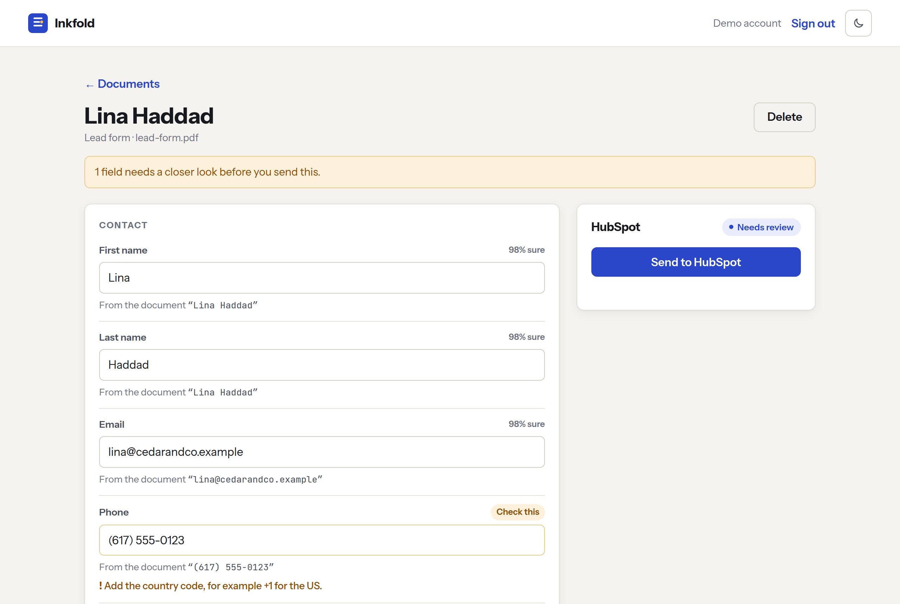
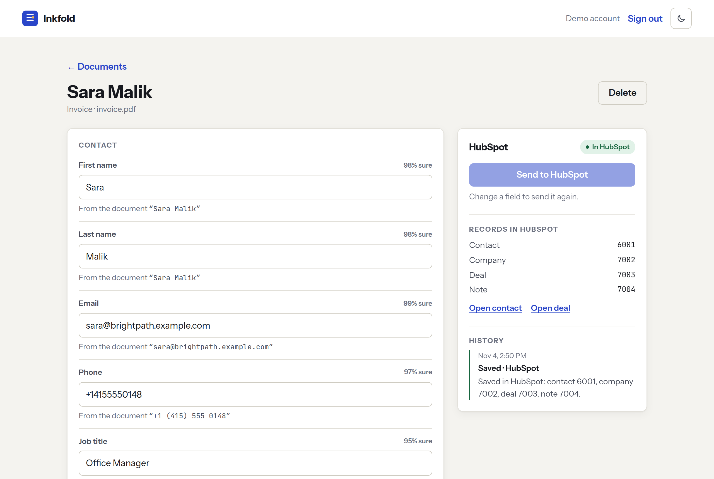

<h1 align="center">📇 Inkfold</h1>

<p align="center">
  <b>Business documents into HubSpot, checked by a person first.</b><br/>
  Upload an invoice, a business card or a lead form. Inkfold reads it, cleans up the fields, shows you what it's unsure about and saves the contact, company, deal and note to HubSpot, directly or through an n8n workflow.
</p>

<p align="center">
  <a href="https://github.com/ahmad-zaman123/Inkfold/actions/workflows/ci.yml"></a>
  <a href="https://inkfold-nine.vercel.app"></a>
  
  
  
  
  
  
  <a href="LICENSE"></a>
</p>

<p align="center">
  <a href="https://inkfold-nine.vercel.app"><b>Live demo → inkfold-nine.vercel.app</b></a><br/>
  <sub>Click <b>Try the live demo</b> to review three sample documents and send one to HubSpot. No sign-up needed.</sub>
</p>

<p align="center">
  <a href="#-quick-start">Quick start</a> ·
  <a href="#-how-it-works">How it works</a> ·
  <a href="#-features">Features</a> ·
  <a href="#-api">API</a> ·
  <a href="#-limits">Limits</a>
</p>

<p align="center">
  <picture>
    <source media="(prefers-color-scheme: dark)" srcset="docs/screenshots/review-dark.png" />
    
  </picture>
</p>

---

## 🧭 What is Inkfold?

Copying details from PDFs and photos into a CRM is slow, and a model that does it unattended will sooner or later put a wrong amount on a deal. Inkfold keeps a person in the loop: the model extracts, code checks and normalizes, the person fixes what's flagged, and only then does anything reach HubSpot.

| 📄 Reads | 🧹 Checks | 🔗 Saves |
|---|---|---|
| PDFs, PNG and JPEG photos and text files, with each field's source text and a confidence score | Emails, phone numbers (E.164), dates, money, currencies and domains, plus whether line items add up to the total | A contact (upserted by email), its company, a deal for an invoice and a note, all linked, in HubSpot |

<p align="center">
  <picture>
    <source media="(prefers-color-scheme: dark)" srcset="docs/screenshots/synced-dark.png" />
    
  </picture>
</p>

The sample documents in [`samples/`](samples/) are made up. All the people and companies in them are fictional.

## 🚀 Quick start

**Prerequisites:** Python 3.12, Node 18+ and a [Gemini API key](https://aistudio.google.com). Sending records needs a HubSpot service key (see **HubSpot setup** below). No Docker needed: `scripts/dev_db.py` starts a bundled Postgres.

**1. Backend** → `http://localhost:8020`

```bash
cd Backend
python3 -m venv .venv
.venv/bin/pip install -r requirements-dev.txt
cp .env.example .env                 # fill in the values
.venv/bin/python scripts/dev_db.py   # put the printed URL in .env as DATABASE_URL
.venv/bin/python scripts/init_db.py  # creates the tables
.venv/bin/uvicorn asgi:app --port 8020
```

**2. Frontend** → `http://localhost:5180`

```bash
cd Frontend
npm install
npm run dev
```

**3. n8n (optional)** → `http://localhost:5690`

To send records through n8n instead of straight to HubSpot, see [`n8n/README.md`](n8n/README.md). It's one script.

**4. Tests**

```bash
cd Backend && .venv/bin/python -m pytest      # 159 tests, real Postgres, fake Gemini and HubSpot
node --test n8n/test/*.test.mjs                # 10 tests for the n8n Code nodes
Backend/.venv/bin/python n8n/test/e2e.py       # API + n8n + fake HubSpot round trip
```

No test calls Gemini or HubSpot, so none of them need keys.

<details>
<summary><b>🔧 Environment variables</b> (<code>Backend/.env</code>)</summary>
<br/>

| Key | Required | Notes |
|---|---|---|
| `DATABASE_URL` | **yes** | Postgres. Use the pooled URL on Neon. |
| `JWT_SECRET` | **yes** | Signs session tokens. Use a long random string. |
| `GEMINI_API_KEY` | **yes** | Reads the documents. |
| `GEMINI_EXTRACT_MODELS` | no | Comma-separated, tried in order when one is busy, out of quota or retired. |
| `HUBSPOT_TOKEN` | to send | HubSpot service key, or a legacy private app token on older accounts. Without it (and without n8n), "Send to HubSpot" explains that HubSpot isn't connected. |
| `HUBSPOT_PORTAL_ID` | no | Your HubSpot account ID, so the app can link to the records it made. |
| `HUBSPOT_DEAL_STAGE` | no | Stage for new deals, by name or ID. Defaults to `closedwon`, since an invoice is a sale that happened. Newer HubSpot accounts use numeric stage IDs, so a name is looked up in the default pipeline. |
| `N8N_WEBHOOK_URL` | no | When set, records go through the n8n workflow instead of straight to HubSpot. |
| `N8N_SHARED_SECRET` | with n8n | Signs requests both ways. Use a long random string. |
| `PUBLIC_API_URL` | with n8n | The address n8n can reach this API at, for its callback. |
| `CORS_ALLOWED_ORIGINS` | prod | The deployed frontend's address, comma-separated if more than one. The first is also used for links in emails. |
| `SMTP_USER`, `SMTP_PASSWORD` | for reset | Turn on password reset by email. For Gmail, use an [app password](https://myaccount.google.com/apppasswords). Without them, "Forgot password?" is hidden. |
| `SMTP_HOST`, `SMTP_PORT`, `EMAIL_FROM` | no | Default to Gmail (`smtp.gmail.com`, `587`) and the `SMTP_USER` address. |
| `UPLOADS_PER_USER_DAY`, `UPLOADS_PER_DAY` | no | Upload limits. Default 10 per user and 100 in total per day. |

Frontend (`Frontend/.env`): `VITE_API_URL` is the deployed backend's address, left empty locally because Vite proxies `/api`.

</details>

<details>
<summary><b>🔑 HubSpot setup</b> (free CRM is enough)</summary>
<br/>

1. In HubSpot, open **Settings → Development → Legacy apps** and choose **Create a service key** (new accounts no longer offer private apps there). Name it Inkfold. On older accounts a legacy private app works too.
2. Give it read and write access to `crm.objects.contacts`, `crm.objects.companies` and `crm.objects.deals`.
3. Put the key in `HUBSPOT_TOKEN`. Your account ID (in the account menu, top right) goes in `HUBSPOT_PORTAL_ID`, so the app can link to the records it creates.

Deals land in the default pipeline at the stage in `HUBSPOT_DEAL_STAGE`. Newer accounts use numeric stage IDs, so Inkfold reads the pipeline and finds "Closed won" for you.

</details>

<details>
<summary><b>🔑 Demo account</b> (live site)</summary>
<br/>

Click **Try the live demo**. You get a private account with three sample documents already read: an invoice, a business card and a lead form. Review them, fix the flagged phone number, and send one to HubSpot. Uploading your own file uses Gemini as normal.

Demo accounts are deleted after two days. Each address can open 10 demos an hour, and 500 can be opened a day in total.

</details>

## 🧩 How it works

```
 upload ──▶ type check by file contents ──▶ duplicate check (sha256)
                                                   │
                                   Gemini, structured JSON output
                                                   │
                       normalize + cross-check (code, not the model)
                                                   │
                       review: fix flagged fields, see where each came from
                                                   │
                   ┌───────────── Send to HubSpot ─┴───────────────────┐
                   ▼ direct                                            ▼ n8n
     contact upsert, company, deal, note,              signed webhook ─▶ workflow ─▶ HubSpot
     default associations                              signed callback ◀────────────┘
                   └──────────────▶ synced, with links to the records ◀┘
```

The model only proposes values. Code decides what they mean: it parses the dates and amounts, works out the currency, formats phone numbers, checks emails and catches line items that don't add up. The document's text is passed as data, and the prompt says so, so instructions hidden in an upload are read as content rather than followed.

## ✨ Features

<table>
<tr>
<td width="50%" valign="top">

### 🔍 Every value shows its source
Each field keeps the text it was read from and a confidence score. Low-confidence fields are flagged, and anything you change is marked "Edited by you".

### 🧮 Checks the model can't skip
Line items are added up and compared with the total. A due date before the issue date is flagged. A deal is only created when the total is clean.

### 🔁 Safe to send twice
Contacts are upserted by email, and a re-send updates the same company, deal and note. A record deleted in HubSpot since the last send is made again. Sending is claimed with one atomic update, so a double click can't create two deals.

### 🧯 Model fallback
If a Gemini model is overloaded, out of quota or retired, the next one in the list is tried, within a 40 second budget. A bad API key is reported as a setup problem, not as a broken file.

### 🔐 Accounts
Passwords hashed with scrypt and 8-hour sessions. Changing or resetting a password signs out every other session. Reset links are single use, expire in 15 minutes and are stored only as hashes, and the reply never reveals whether an email has an account.

</td>
<td width="50%" valign="top">

### 🔀 Direct or through n8n
The same HubSpot calls run either in the API or in an n8n workflow you can extend with your own steps. The workflow ships as JSON with its Code nodes kept as tested source files.

### ✍️ Signed both ways
Requests to n8n and its callbacks carry an HMAC-SHA256 signature over the timestamp and exact body, checked in constant time and refused after 5 minutes. A repeated callback changes nothing.

### 🛡️ Careful uploads
4 MB limit, file type checked from the bytes rather than the name, filenames cleaned, duplicate uploads spotted, and per-user and global daily limits stored in Postgres.

### 🧪 Private demos
"Try the demo" creates a private account with three sample documents already read, so it costs no Gemini calls. Demo accounts are deleted after two days.

</td>
</tr>
</table>

## 🔌 API

| Method | Path | What it does |
|---|---|---|
| `POST` | `/api/auth/register`, `/api/auth/login` | Create an account or sign in. Returns a token. |
| `POST` | `/api/auth/demo` | Create a private demo account with sample documents. |
| `GET` | `/api/me` | The signed-in user. |
| `GET` | `/api/auth/options` | Which sign-in extras are turned on, such as password reset. |
| `POST` | `/api/password/forgot`, `/api/password/reset` | Email a reset link, then use it to set a new password. |
| `POST` | `/api/me/password` | Change the password. Signs out every other session and returns a new token. |
| `POST` | `/api/documents` | Upload a file (multipart `file`). Returns the extracted document. |
| `GET` | `/api/documents`, `/api/documents/{id}` | List documents, or one with its fields, issues and sync history. |
| `PATCH` | `/api/documents/{id}/fields` | Save edits, as `{"fields": {"contact.phone": "+1 617 555 0123"}}`. |
| `POST` | `/api/documents/{id}/sync` | Send to HubSpot. `422` with the missing fields if it isn't ready. |
| `POST` | `/api/sync/callback` | n8n's signed result. |
| `DELETE` | `/api/documents/{id}` | Delete a document from Inkfold (not from HubSpot). |

## 🚦 Limits

- One contact per document. Inkfold reads a single person from each file.
- Scanned PDFs work when Gemini can read them; there's no separate OCR step.
- Deleting a document in Inkfold leaves its HubSpot records in place.
- Deals use HubSpot's default pipeline.

## 🛠️ Tech stack

| Layer | Tech |
|---|---|
| **Backend** | Python 3.12, FastAPI, psycopg 3, PyJWT, phonenumbers |
| **AI** | Google Gemini with structured JSON output and model fallback |
| **CRM** | HubSpot CRM API v3 and v4 associations |
| **Automation** | n8n 2.x workflow with Code nodes and HMAC-signed webhooks |
| **Frontend** | React 18, Vite, React Router |
| **Data** | PostgreSQL on Neon |
| **Deployment** | Vercel (serverless Python + static React) |

## 🗂️ Project structure

```
Inkfold/
├── Backend/
│   ├── api/index.py        Vercel entry point
│   ├── app/
│   │   ├── config.py       settings from the environment
│   │   ├── crm.py          HubSpot client: upserts, search, associations, stage lookup
│   │   ├── demo_data.py    the demo's pre-read sample documents
│   │   ├── extract.py      Gemini extraction with model fallback
│   │   ├── mailer.py       password reset emails over SMTP
│   │   ├── main.py         API routes, auth, uploads, rate limits
│   │   ├── normalize.py    field cleaning and cross-checks
│   │   ├── schema.py       the fields Inkfold extracts
│   │   ├── store.py        schema and every SQL query
│   │   └── sync.py         signing and the n8n hand-off
│   ├── scripts/            local Postgres and table setup
│   ├── tests/              159 tests against a real Postgres
│   ├── asgi.py
│   ├── requirements.txt
│   └── vercel.json
├── Frontend/
│   ├── src/
│   │   ├── components/     upload, field rows, line items, HubSpot panel
│   │   ├── pages/          landing, sign-in, password reset, account, documents, review
│   │   ├── api.js          API client
│   │   └── styles.css
│   ├── package.json
│   └── vercel.json
├── n8n/
│   ├── document-to-hubspot.json   the workflow to import
│   ├── src/                       its Code nodes as plain files
│   ├── test/                      Code node tests and the end-to-end check
│   └── run-local.sh
├── samples/                fictional invoice, business card and lead form
└── docs/screenshots/
```

## ☁️ Deployment & CI

- **Vercel**, as two projects from this repo: `Backend` (serverless Python) and `Frontend` (Vite). Postgres is on Neon. Set `DATABASE_URL`, `JWT_SECRET`, `GEMINI_API_KEY`, `HUBSPOT_TOKEN`, `HUBSPOT_PORTAL_ID` and `CORS_ALLOWED_ORIGINS` on the backend, and `VITE_API_URL` on the frontend. Create the tables once with `scripts/init_db.py`.
- **CI** (`ci.yml`) runs the backend tests, the n8n Code node tests, a check that the workflow JSON matches its source files, and the frontend build on every push and pull request.

## 📄 License

[MIT](LICENSE) © 2026 Ahmad Zaman
